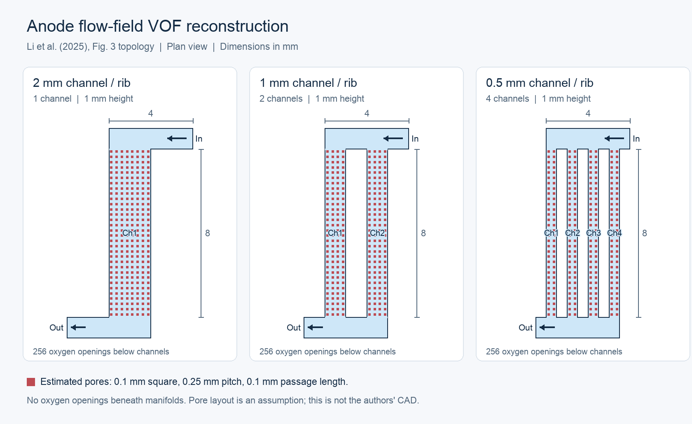

# Li et al. anode flow-field VOF model in OpenFOAM

A runnable reconstruction of the **anode VOF submodel** in Wenjia Li et al.,
*Volume of fluid coupled multiphysics modeling of anion exchange membrane water
electrolyzers and flow field design*, IJHMT 252 (2025), 127446.
[Paper DOI](https://doi.org/10.1016/j.ijheatmasstransfer.2025.127446).

The three cases reproduce the channel/manifold topology in Figure 3, the reported
channel dimensions, water/oxygen VOF physics, wall wetting, gravity, and nominal
inlet conditions. They use **OpenCFD OpenFOAM v2312 `interFoam`**, laminar,
isothermal, incompressible water and oxygen. Every case contains explicit oxygen
inlet passages beneath the channels. No gas is injected beneath either manifold.

**Status:** reconstructed model with documented estimates, not a quantitatively
validated reproduction of the paper. The paper does not provide the spatial oxygen
feed from its electrochemical model, the exact pore layout, or its numerical case.
The user approved documented estimates. This package does not solve the coupled
electrochemical/thermal model or predict current density from cell voltage.
See [the model specification](docs/model.md) and [verification results](docs/verification.md).

The portable bundle is `output/li-vof-openfoam-v2312.zip` in the workspace. Rebuild
it with `python3 scripts/package_case.py` after generating all three clean cases.
It includes the case files and verification evidence, but excludes the supplied
paper and large transient field snapshots.



## Ready-to-use cases

The generated directories are present in this workspace. They are ignored by Git
because they contain large, reproducible meshes and simulation output.

| Case | Channels | Channel/rib width | Medium-mesh cells |
|---|---:|---:|---:|
| `cases/w2mm` | 1 | 2 mm | 198,868 |
| `cases/w1mm` | 2 | 1 mm | 202,888 |
| `cases/w0.5mm` | 4 | 0.5 mm | 210,928 |

All three have a channel height of 1 mm, channel length of 8 mm, 4 × 1 × 1 mm
manifolds, and 256 estimated square oxygen passages of width 0.1 mm. The channel
volume is 16 mm³, manifold volume is 8 mm³, and passage volume is 0.256 mm³.

## Run

From `/Users/zhuang/FlowField`, with Docker Desktop running:

The `parallel` commands below are for cases without existing `processor*`
directories. For an already decomposed case, resume with its original process
count or create a fresh case as described under **Run on one or two CPU cores**.

```bash
# Validate a ready-made mesh.
./Problem1/scripts/run_case.sh Problem1/cases/w1mm check

# Run the 1 mm case to the configured 1 s endpoint on four processes.
./Problem1/scripts/run_case.sh Problem1/cases/w1mm parallel 4

# Run the other widths when resources permit.
./Problem1/scripts/run_case.sh Problem1/cases/w2mm parallel 4
./Problem1/scripts/run_case.sh Problem1/cases/w0.5mm parallel 4

# Analyze the paper's 0.2–1.0 s comparison interval.
python3 Problem1/scripts/analyze.py Problem1/cases/w2mm Problem1/cases/w1mm \
  Problem1/cases/w0.5mm --output Problem1/results/summary.json
```

Alternatively, enter `Problem1` first. All commands in the remaining sections
assume this working directory:

```bash
cd /Users/zhuang/FlowField/Problem1
./scripts/run_case.sh cases/w1mm parallel 4
```

The Bash wrappers locate the project from their own script location. Case paths
can be absolute, relative to your current directory, or relative to `Problem1`.
For example, `./Problem1/scripts/run_case.sh cases/w1mm check` also works from
`FlowField`. `foam.sh` translates these host paths into the mounted container paths.

The wrapper uses the locally installed `opencfd/openfoam-default:2312` image and
mounts only the `Problem1` folder at `/work`. It runs as the host user so the
diagnostic function can compile safely. Core Python scripts require only the standard library; the optional
`plot_results.py` requires Pillow. On a Linux host
with OpenCFD v2312 already sourced, set `FLOWFIELD_NATIVE=1`.

The simulation uses microsecond time steps to resolve capillary dynamics at the
pores. A 1 s calculation is a substantial CFD job; plan for many hours or longer
depending on mesh and hardware. The default 0.01 s field-write interval produces
about 100 snapshots. CSV diagnostics are written every solver step.

Solver output now appears live in the terminal for serial, parallel, and resumed
runs, while the full output is also appended to `log.interFoam`. The lines
`Time = ...` and `deltaT = ...` show the simulation time and current time-step size
in seconds. `ExecutionTime` and `ClockTime` show computation and elapsed wall time.
To monitor the same log from another terminal:

```bash
tail -f cases/w1mm/log.interFoam
```

Open `cases/w1mm/flowfield.foam` in ParaView. Show an `alpha.water = 0.5`
contour for the gas/liquid interface, and use `1-alpha.water` for gas fraction.
Parallel runs are reconstructed automatically on successful completion.

To extend a completed run, update `endTime` and resume with the same process count:

```bash
./scripts/foam.sh foamDictionary cases/w1mm/system/controlDict -entry endTime -set 1.2
./scripts/run_case.sh cases/w1mm resume 4
```

## Run on one or two CPU cores

The process count selects how many CPU workers solve the case. The mesh cell
count stays the same; parallel workers each handle a portion of it.

| CPU workers | Launcher mode |
|---|---|
| 1 | `run` (serial) |
| 2 | `parallel 2` |
| 4 | `parallel 4` |

Choose one of the following blocks to create a separate **1 mm, medium-mesh case**
and run it from **time zero**. These commands preserve the existing cases and
results. Stop any existing simulation first if the purpose is to reduce total CPU
usage; starting another case does not stop the previous one.

**One CPU core:**

```bash
cd /Users/zhuang/FlowField/Problem1
python3 scripts/generate_cases.py --output runs/one-core --widths 1 --mesh medium
./scripts/run_case.sh runs/one-core/w1mm run
```

**Two CPU cores:**

```bash
cd /Users/zhuang/FlowField/Problem1
python3 scripts/generate_cases.py --output runs/two-core --widths 1 --mesh medium
./scripts/run_case.sh runs/two-core/w1mm parallel 2
```

Both modes display `Time` and `deltaT` live and save output to the selected case's
`log.interFoam`. The generator refuses to overwrite an existing case. To continue
one of these runs from its latest saved checkpoint, use the corresponding command
instead of generating it again:

```bash
# Resume the serial case.
./scripts/run_case.sh runs/one-core/w1mm resume

# Resume the two-process case.
./scripts/run_case.sh runs/two-core/w1mm resume 2
```

**Changing the worker count of an existing parallel case:** a case with
`processor0` through `processor3` is decomposed for four workers. Use `resume 4`
to continue that decomposition. Changing it to `resume 2` does not repartition
the mesh. To retain its saved progress while changing the count, stop the solver,
reconstruct the saved fields, and prepare a new decomposition for the desired
count (or a reconstructed serial case). The fresh-run commands above do not
perform that checkpoint conversion.

## Generate alternative cases

The generator refuses to overwrite a nonempty directory. Use a distinct output
directory for each study so existing results remain intact.

```bash
# Re-create all medium cases in a new directory.
python3 scripts/generate_cases.py --output runs/rebuilt --mesh medium

# A short startup test; this is not a quasi-steady comparison.
python3 scripts/generate_cases.py --output runs/startup --mesh coarse \
  --end-time 0.001 --write-interval 0.0002
./scripts/run_case.sh runs/startup/w1mm run
python3 scripts/analyze.py runs/startup/w1mm --allow-short --output results/startup.json

# Feed-rate sensitivity (A/cm²), with the same current for every selected width.
python3 scripts/generate_cases.py --output runs/current1 --current-density 1.0

# Pure-water inlet sensitivity: the paper's default inlet water fraction is 0.9.
python3 scripts/generate_cases.py --output runs/pure-water --inlet-alpha 1

# Refined mesh; four cells across each pore instead of two.
python3 scripts/generate_cases.py --output runs/fine --mesh fine

# Validate physical invariants and time-weighted statistics.
python3 -m unittest discover -s tests -v
```

Edit a copy of `config/reference.json` and pass `--config` to vary pore spacing,
contact angle, material properties, gravity, or other inputs. See the specification
for which inputs are reported and which are assumptions. To change the current
for only one width, generate that width separately using `--widths 1`.

## Outputs and interpretation

Each case contains:

- `case_metadata.json`: all input parameters, Faraday-law calculations, mesh counts,
  and time-step cap.
- `constant/polyMesh`: conformal hexahedral mesh, channel cell zones, and internal
  `poreMouths` face zone.
- `log.checkMesh` and `log.interFoam`: mesh and solver evidence.
- `postProcessing/bubbleMetrics/metrics.csv`: channel-only gas fraction, bottom/top/
  side coverage, pressure drop, alpha bounds, and conservation diagnostics.
- `flowfield.foam`: ParaView entry point.

Coverage is reported both over the solid bottom wall and over the complete
channel bottom including pore mouths. The paper does not specify its exact
coverage integration/threshold procedure. Both measures are retained to make this
ambiguity visible. The summary applies Eqs. (44)–(45) to the mean complete-bottom
coverage to calculate bubble overpotential and active-area factor; these are
coupling outputs, not a replacement electrochemical solver.

The analyzer refuses to report a requested sampling interval unless it is present,
unless `--allow-short` is explicitly supplied. Completion of the interval alone
does not establish stationarity, mesh independence, or agreement with the paper.

## Relevant sources

- Supplied paper: Tables 1–3, Fig. 3, Sections 2.3.2, 2.4, and 3.3.
- [OpenFOAM v2312 interFoam documentation](https://doc.openfoam.com/2312/tools/processing/solvers/rtm/multiphase/interFoam/).
- [OpenFOAM v2312 fixedFluxPressure documentation](https://doc.openfoam.com/2312/tools/processing/boundary-conditions/rtm/derived/inlet/fixedFluxPressure/).
- Installed v2312 solver source and `damBreak` tutorial were checked for field,
  boundary-condition, and PIMPLE compatibility.
