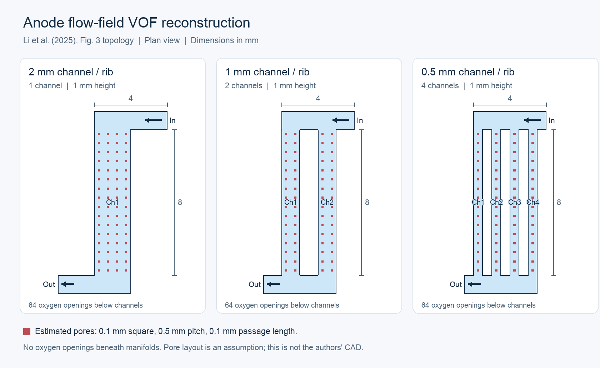

# Li et al. anode flow-field VOF model in OpenFOAM

A runnable reconstruction of the **anode VOF submodel** in Wenjia Li et al.,
*Volume of fluid coupled multiphysics modeling of anion exchange membrane water
electrolyzers and flow field design*, IJHMT 252 (2025), 127446.
[Paper DOI](https://doi.org/10.1016/j.ijheatmasstransfer.2025.127446).

The three cases reproduce the channel/manifold topology in Figure 3, the reported
channel dimensions, water/oxygen VOF physics, wall wetting, gravity, and nominal
inlet conditions. They use **OpenCFD OpenFOAM v2312 `interFoam`**, laminar,
isothermal, incompressible water and oxygen. Every case contains explicit oxygen
inlet passages beneath the channels. No gas is injected beneath either manifold.

**Status:** reconstructed model with documented estimates, not a quantitatively
validated reproduction of the paper. The paper does not provide the spatial oxygen
feed from its electrochemical model, the exact pore layout, or its numerical case.
The user approved documented estimates. This package does not solve the coupled
electrochemical/thermal model or predict current density from cell voltage.
See [the model specification](docs/model.md) and [verification results](docs/verification.md).

**4 November 2026 production-case audit:** the copied `cases/w1mm` has results
through 1 s, but six processor meshes are missing and the solver histories overlap.
The available data are closely bounded with small conservation residuals; the
complete run is not certified. See the [stability and ParaView report](docs/w1mm_stability_2026-11-04.md).

**New defaults:** 64 oxygen openings (0.5 mm pitch), diagnostics every 10 solver
steps plus the final step, and ParaView fields every 0.01 s. The opening count
and spacing are modeling estimates. Total oxygen production is preserved; inlet
velocity at each opening rises fourfold. Existing 256-opening solutions remain
in `cases/w*mm`; the new meshes are separate in `cases/openings64/w*mm`.

The updated portable bundle is `output/li-vof-openfoam-v2312-64-openings.zip`.
Rebuild it with `python3 scripts/package_case.py` from `Problem1`. It includes
the three new initial cases, source, documentation, and verification evidence;
large transient snapshots are excluded. The old archive is preserved.

To use the bundle without replacing your existing server project, upload the ZIP
to `~/FlowField` and extract it into a new directory:

```bash
cd ~/FlowField
unzip li-vof-openfoam-v2312-64-openings.zip -d openings64-release
cd openings64-release/Problem1
# After loading native OpenCFD v2312 and MPI as shown below:
./scripts/run_case.sh cases/openings64/w1mm parallel 16
```

The bundle already contains the new medium meshes, so no generation is needed.



## Ready-to-use cases

The generated directories are present in this workspace. They are ignored by Git
because they contain large, reproducible meshes and simulation output.

| Case | Channels | Channel/rib width | Medium-mesh cells |
|---|---:|---:|---:|
| `cases/openings64/w2mm` | 1 | 2 mm | 192,512 |
| `cases/openings64/w1mm` | 2 | 1 mm | 192,512 |
| `cases/openings64/w0.5mm` | 4 | 0.5 mm | 192,512 |

All three have a channel height of 1 mm, channel length of 8 mm, 4 × 1 × 1 mm
manifolds, and 64 estimated square oxygen passages of width 0.1 mm. The channel
volume is 16 mm³, manifold volume is 8 mm³, and passage volume is 0.064 mm³.
The 1 mm design has 32 openings beneath each channel. Coarse versions have
32,352 cells each. Fewer openings alone reduce the 1 mm medium mesh by only 5.1%;
no measured runtime speedup is claimed. The changed gas distribution can affect
bubble coverage and detachment.

On the server, copy the updated `scripts/`, `templates/`, and `config/` files,
then generate a fresh case and run it using your loaded OpenFOAM environment:

```bash
cd ~/FlowField
python3 Problem1/scripts/generate_cases.py --output Problem1/cases/openings64 \
  --widths 1 --mesh medium --metrics-every 10
./Problem1/scripts/run_case.sh Problem1/cases/openings64/w1mm parallel 16
```

Generation refuses to overwrite existing data. If the new generated case has
already been copied to the server, skip generation. Start the changed geometry
from time zero; do not resume the 256-opening fields on this mesh. Use only the
CPU allocation assigned to the job.

To restore the original estimated geometry in a separate directory, use
`--config Problem1/config/legacy_256.json`. That configuration also restores
every-step diagnostics. `--pore-pitch 0.25 --metrics-every 10` instead combines
the old opening layout with the new diagnostic sampling.

## Run

From `/Users/zhuang/FlowField`, with Docker Desktop running:

The `parallel` commands below are for cases without existing `processor*`
directories. For an already decomposed case, resume with its original process
count or create a fresh case as described under **Run on one or two CPU cores**.

```bash
# Validate a ready-made mesh.
./Problem1/scripts/run_case.sh Problem1/cases/openings64/w1mm check

# Run the 1 mm case to the configured 1 s endpoint on four processes.
./Problem1/scripts/run_case.sh Problem1/cases/openings64/w1mm parallel 4

# Run the other widths when resources permit.
./Problem1/scripts/run_case.sh Problem1/cases/openings64/w2mm parallel 4
./Problem1/scripts/run_case.sh Problem1/cases/openings64/w0.5mm parallel 4

# Analyze the paper's 0.2–1.0 s comparison interval.
python3 Problem1/scripts/analyze.py Problem1/cases/openings64/w2mm Problem1/cases/openings64/w1mm \
  Problem1/cases/openings64/w0.5mm --output Problem1/results/summary.json
```

Alternatively, enter `Problem1` first. Later examples use this working directory
unless a block includes its own `cd` command:

```bash
cd /Users/zhuang/FlowField/Problem1
./scripts/run_case.sh cases/openings64/w1mm parallel 4
```

The Bash wrappers locate the project from their own script location. Case paths
can be absolute, relative to your current directory, or relative to `Problem1`.
For example, `./Problem1/scripts/run_case.sh cases/openings64/w1mm check` also works from
`FlowField`. `foam.sh` translates these host paths into the mounted container paths.

The wrapper automatically uses a native OpenCFD v2312 environment when it is
loaded (`WM_PROJECT_VERSION` is `2312` or `v2312`). Otherwise, it uses the locally
installed `opencfd/openfoam-default:2312` Docker image and mounts only the
`Problem1` folder at `/work`. The container runs as the host user so the diagnostic
function can compile safely. Set `FLOWFIELD_NATIVE=1` to require native OpenFOAM,
or `FLOWFIELD_NATIVE=0` to require Docker; unset the variable or set it to `auto`
to restore automatic selection. Core Python scripts require only the standard
library; the optional `plot_results.py` requires Pillow.

The simulation uses microsecond time steps to resolve capillary dynamics at the
pores. A 1 s calculation is a substantial CFD job; plan for many hours or longer
depending on mesh and hardware. The default 0.01 s field-write interval produces
about 100 snapshots. New cases write CSV diagnostics every **10 solver steps**
and at the final step, controlled by `--metrics-every`. The pressure/phase
equations still advance every solver step. Recorded extrema apply only to the
sampled steps; use `--metrics-every 1` for detailed stability diagnostics.

Solver output now appears live in the terminal for serial, parallel, and resumed
runs, while the full output is also appended to `log.interFoam`. The lines
`Time = ...` and `deltaT = ...` show the simulation time and current time-step size
in seconds. `ExecutionTime` and `ClockTime` show computation and elapsed wall time.
To monitor the same log from another terminal:

```bash
tail -f cases/openings64/w1mm/log.interFoam
```

For ParaView, use the workflow below. Parallel runs are reconstructed automatically
only after successful launcher completion; the current copied `w1mm` results are
still decomposed.

To extend a completed run, update `endTime` and resume with the same process count:

```bash
./scripts/foam.sh foamDictionary cases/openings64/w1mm/system/controlDict -entry endTime -set 1.2
./scripts/run_case.sh cases/openings64/w1mm resume 4
```

## Run on a Linux university server

For the home-directory OpenCFD v2312 installation at
`$HOME/OpenFOAM/OpenFOAM-v2312`, run this setup in **each new terminal or job
session**. Adjust the installation path if OpenFOAM was installed elsewhere:

```bash
module load mpi/openmpi-x86_64
source "$HOME/OpenFOAM/OpenFOAM-v2312/etc/bashrc"
export FLOWFIELD_NATIVE=1

cd ~/FlowField
./Problem1/scripts/run_case.sh Problem1/cases/openings64/w1mm check
```

`FLOWFIELD_NATIVE=1` explicitly selects the server installation and also works
with older copies of the launcher. It does not install or load OpenFOAM by itself.
The updated launcher can select a loaded v2312 environment automatically, but the
MPI module and OpenFOAM environment still need loading after a new login. If you
see `exec: docker: not found`, your server has an older launcher and native mode
was not enabled in that terminal; run the setup above before trying again.

For a fresh case, use the number of CPU cores assigned to your job, for example:

```bash
cd ~/FlowField
./Problem1/scripts/run_case.sh Problem1/cases/openings64/w1mm parallel 16
```

For an existing parallel run, use `resume` with its **original** process count.
For example, use `resume 16` only if the case was decomposed for 16 processes;
a case previously run with two processes must use `resume 2` until it is
repartitioned. Neither `parallel` nor `resume` changes how OpenFOAM is selected.
Hardware counts from `nproc` or `lscpu` do not establish your job's CPU allocation.

## Run on one or two CPU cores

The process count selects how many CPU workers solve the case. The mesh cell
count stays the same; parallel workers each handle a portion of it.

| CPU workers | Launcher mode |
|---|---|
| 1 | `run` (serial) |
| 2 | `parallel 2` |
| 4 | `parallel 4` |

Choose one of the following blocks to create a separate **1 mm, medium-mesh case**
and run it from **time zero**. These commands preserve the existing cases and
results. Stop any existing simulation first if the purpose is to reduce total CPU
usage; starting another case does not stop the previous one.

**One CPU core:**

```bash
cd /Users/zhuang/FlowField/Problem1
python3 scripts/generate_cases.py --output runs/one-core --widths 1 --mesh medium
./scripts/run_case.sh runs/one-core/w1mm run
```

**Two CPU cores:**

```bash
cd /Users/zhuang/FlowField/Problem1
python3 scripts/generate_cases.py --output runs/two-core --widths 1 --mesh medium
./scripts/run_case.sh runs/two-core/w1mm parallel 2
```

Both modes display `Time` and `deltaT` live and save output to the selected case's
`log.interFoam`. The generator refuses to overwrite an existing case. To continue
one of these runs from its latest saved checkpoint, use the corresponding command
instead of generating it again:

```bash
# Resume the serial case.
./scripts/run_case.sh runs/one-core/w1mm resume

# Resume the two-process case.
./scripts/run_case.sh runs/two-core/w1mm resume 2
```

**Changing the worker count of an existing parallel case:** a case with
`processor0` through `processor3` is decomposed for four workers. Use `resume 4`
to continue that decomposition. Changing it to `resume 2` does not repartition
the mesh. To retain its saved progress while changing the count, stop the solver,
reconstruct the saved fields, and prepare a new decomposition for the desired
count (or a reconstructed serial case). The fresh-run commands above do not
perform that checkpoint conversion.

## Generate alternative cases

The generator refuses to overwrite a nonempty directory. Use a distinct output
directory for each study so existing results remain intact.

```bash
# Re-create all medium cases in a new directory.
python3 scripts/generate_cases.py --output runs/rebuilt --mesh medium

# A short startup test; this is not a quasi-steady comparison.
python3 scripts/generate_cases.py --output runs/startup --mesh coarse \
  --end-time 0.001 --write-interval 0.0002
./scripts/run_case.sh runs/startup/w1mm run
python3 scripts/analyze.py runs/startup/w1mm --allow-short --output results/startup.json

# Feed-rate sensitivity (A/cm²), with the same current for every selected width.
python3 scripts/generate_cases.py --output runs/current1 --current-density 1.0

# Pure-water inlet sensitivity: the paper's default inlet water fraction is 0.9.
python3 scripts/generate_cases.py --output runs/pure-water --inlet-alpha 1

# Refined mesh; four cells across each pore instead of two.
python3 scripts/generate_cases.py --output runs/fine --mesh fine

# Validate physical invariants and time-weighted statistics.
python3 -m unittest discover -s tests -v
```

Edit a copy of `config/reference.json` and pass `--config` to vary pore spacing,
contact angle, material properties, gravity, or other inputs. See the specification
for which inputs are reported and which are assumptions. To change the current
for only one width, generate that width separately using `--widths 1`.

## Outputs and interpretation

### View a large parallel case in ParaView

Open `cases/w1mm/flowfield.foam` at the case root. Select **Case Type → Decomposed
Case**, **internalMesh**, and the **alpha.water** array, then Apply. Keep cell-to-point
data enabled. Select a saved time, then apply **Contour → alpha.water → 0.5** and
hide the original opaque volume. Water has alpha = 1 and oxygen alpha = 0; use
the Calculator expression `1 - alpha.water` for oxygen fraction. Enable `U` and
`p` only when you need them. If only time zero is shown, disable the advanced
**List timesteps according to controlDict** option.

The current local copy lacks meshes in processors **1, 10, 11, 12, 14, and 15**.
ParaView otherwise shows an incomplete domain. Restore those original meshes or
make a small bundle on the server, after the solver has stopped writing. Copy
the updated `package_view.py` script to the server first:

```bash
cd ~/FlowField
python3 Problem1/scripts/package_view.py Problem1/cases/w1mm \
  --times 1 --output w1mm-view.tar.gz
```

Transfer and extract that archive, then open `w1mm-view/flowfield.foam` as a
**Decomposed Case**. For an animation subset use `--times 0.2,0.4,0.6,0.8,1` and a
different archive name. This keeps only selected fields/times and the meshes;
logs and compiled code are excluded. It never modifies the source case and rejects
missing meshes. This is a visualization subset, not a restart case. For the original 256-opening `w1mm`, verify **202,888 internal cells**;
for the new 64-opening medium case, verify **192,512 internal cells**.

The [audit report](docs/w1mm_stability_2026-11-04.md) includes detailed viewing
steps, numerical findings, and optional compressed output settings for future runs.

### Saved data

Each case contains:

- `case_metadata.json`: all input parameters, Faraday-law calculations, mesh counts,
  and time-step cap.
- `constant/polyMesh`: conformal hexahedral mesh, channel cell zones, and internal
  `poreMouths` face zone.
- `log.checkMesh` and `log.interFoam`: mesh and solver evidence.
- `postProcessing/bubbleMetrics/metrics.csv`: channel-only gas fraction, bottom/top/
  side coverage, pressure drop, alpha bounds, and conservation diagnostics.
- `flowfield.foam`: ParaView entry point.

Coverage is reported both over the solid bottom wall and over the complete
channel bottom including pore mouths. The paper does not specify its exact
coverage integration/threshold procedure. Both measures are retained to make this
ambiguity visible. The summary applies Eqs. (44)–(45) to the mean complete-bottom
coverage to calculate bubble overpotential and active-area factor; these are
coupling outputs, not a replacement electrochemical solver.

The analyzer refuses to report a requested sampling interval unless it is present,
unless `--allow-short` is explicitly supplied. Completion of the interval alone
does not establish stationarity, mesh independence, or agreement with the paper.

## Relevant sources

- Supplied paper: Tables 1–3, Fig. 3, Sections 2.3.2, 2.4, and 3.3.
- [OpenFOAM v2312 interFoam documentation](https://doc.openfoam.com/2312/tools/processing/solvers/rtm/multiphase/interFoam/).
- [OpenFOAM v2312 fixedFluxPressure documentation](https://doc.openfoam.com/2312/tools/processing/boundary-conditions/rtm/derived/inlet/fixedFluxPressure/).
- Installed v2312 solver source and `damBreak` tutorial were checked for field,
  boundary-condition, and PIMPLE compatibility.
