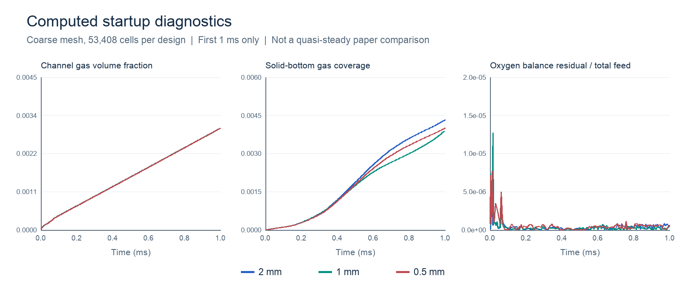

# Verification record

Verified on 23 October 2026 using the installed ARM64 Docker image
`opencfd/openfoam-default:2312` and OpenCFD OpenFOAM v2312. The existing image was
used; no solver installation or image download was needed.

## Checks completed

- Five Python tests pass: equal physical volumes and oxygen feed across all three
  arrangements, mesh refinement preserving pore geometry, Faraday-law scaling,
  rejection of invalid inputs, and physical-time weighting on nonuniform samples.
- All three medium meshes pass `checkMesh -allTopology -allGeometry`, with zero
  nonorthogonality, positive volumes, and valid topology. Coarse meshes also pass.
- `interFoam` runs on all three coarse meshes to approximately 0.001 s.
- All three medium meshes run to 0.000020 s; the 1 mm medium case runs on four MPI
  processes, including successful decomposition and field reconstruction.
- The compiled diagnostic function writes channel-only volume fraction, surface
  coverages, pressure drop, raw cell alpha extrema, and phase-conservation checks
  in both serial and parallel runs.
- Serial restart from the latest saved state and clean wrapper completion were
  exercised. The 1 mm coarse run was extended after its first 0.000020 s test.

The test runs are separate from `cases/`, which contains clean initial conditions
and the configured 1 s runs. No background solver jobs are left running.

Launcher update verified on 24 October 2026 after moving the project into
`Problem1`: dictionary paths resolve from both `FlowField` and `Problem1`, and
project-relative case paths also work when launched from `FlowField`. A separate
four-process test in `runs/wrapper-check-20261024/w1mm` completed two 10⁻⁶ s steps
and reconstructed successfully. Both `Time` and `deltaT` appeared live and in the
saved solver log. The launcher now preserves command arguments while sourcing
OpenFOAM's environment, then streams solver output through `tee` with `pipefail`.

## Coarse startup results

Each coarse mesh contains 53,408 cells. These meshes retain two cells across each
oxygen passage but use coarser channel and manifold cells.

| Channel width | Last diagnostic time (s) | Maximum cell alpha | Largest oxygen residual / imposed O2 feed |
|---|---:|---:|---:|
| 2 mm | 0.001000000 | 1.00000001699 | 7.3224 × 10⁻⁶ |
| 1 mm | 0.001001818 | 1.00000001809 | 1.2739 × 10⁻⁵ |
| 0.5 mm | 0.001000000 | 1.00000001802 | 7.6902 × 10⁻⁶ |

The largest alpha overshoot in these **cell** values is 1.81 × 10⁻⁸. The diagnostic
acceptance tolerance is 10⁻⁷. Contact-angle boundary extrapolations are not included
in these cell extrema. Surface coverage is clipped to [0,1], while raw internal
alpha is retained for volume and conservation calculations.

The largest relative oxygen residual is approximately **0.001274%** of the imposed
oxygen feed (electrolysis feed plus gas entering with the main inlet). This is an
instantaneous discrete balance check, not a demonstrated convergence error bound.
The small endpoint overshoot of the restarted 1 mm case is recorded rather than
rounded away. Its summary integrates the actual available time samples.



Machine-readable details: `results/startup_summary.json`. Every value is computed
from the corresponding solver CSV; none is digitized from or fitted to the paper.

## Medium-mesh startup results

| Channel width | Cells | Execution | Final physical time |
|---|---:|---|---:|
| 2 mm | 198,868 | Serial | 0.000020 s |
| 1 mm | 202,888 | Four MPI processes, reconstructed | 0.000020 s |
| 0.5 mm | 210,928 | Serial | 0.000020 s |

All three pass the same 10⁻⁷ cell-alpha bound tolerance. Maximum relative oxygen
balance residuals are below 4.7 × 10⁻⁶ over these short tests. Detailed results are
in `results/medium_summary.json`. This verifies that the intended production meshes
and parallel workflow execute; it is not a serial/parallel equivalence study.

## Evidence retained

`results/verification_logs/coarse/` and `results/verification_logs/medium/` contain
each case's mesh log, solver log, metadata, and diagnostic CSV. The parallel case
also includes decomposition and reconstruction logs. The full field snapshots are
available in this workspace under `runs/check/` and `runs/medium/`; these larger
temporary runs are excluded from the portable case archive.

The source-only reproduction, from `/Users/zhuang/FlowField/Problem1`, is:

```bash
python3 -m unittest discover -s tests -v
python3 scripts/generate_cases.py --output runs/new-check --mesh coarse \
  --end-time 0.001 --write-interval 0.0002
./scripts/run_case.sh runs/new-check/w2mm run
./scripts/run_case.sh runs/new-check/w1mm run
./scripts/run_case.sh runs/new-check/w0.5mm run
python3 scripts/analyze.py runs/new-check/w2mm runs/new-check/w1mm \
  runs/new-check/w0.5mm --allow-short --output results/new-check.json
```

## What these checks do not establish

The longest test is about 1 ms. The paper assesses bubble evolution up to 1 s and
selects a quasi-steady comparison after 0.2 s. The completed tests do **not** cover
that interval, resolved bubble detachment cycles, long-time stability, mesh/time
independence, or the paper's coverage/current-density rankings. Startup pressure
drops are dominated by initialization and should not be used as operating values.

The 1 s production runs and grid/time-step sensitivity studies remain to be run.
The estimates for pore geometry and oxygen generation also prevent a claim of
exact reproduction even after those runs finish. The case metadata and model
specification record these limitations explicitly.
