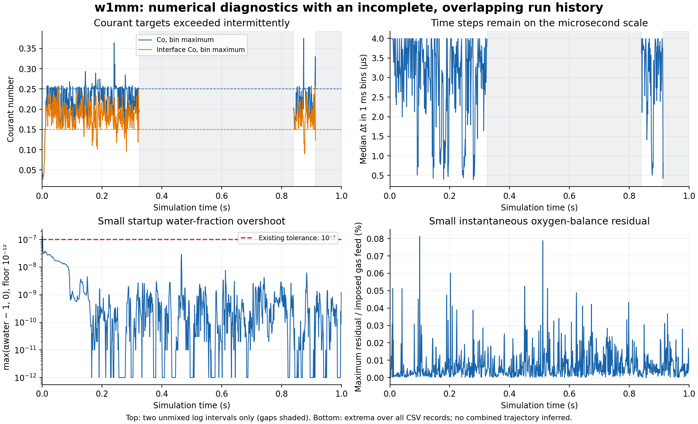

# w1mm visualization and numerical audit — 4 November 2026

**Finding:** the available numerical data are bounded and have small instantaneous
conservation residuals, but this is **not a fully verified production run**.
Overlapping solver output, an incomplete log, and missing local processor meshes
prevent that conclusion. No solver settings or existing result files were changed.

## Data integrity comes first

The copied `cases/w1mm` occupies about **5.4 GiB**, including a **1.14 GiB** solver
log. All 16 processor folders contain the six field files at 100 positive saved
times, from 0.01 to 1 s. The original mesh has 202,888 cells.

However, `processor1`, `processor10`, `processor11`, `processor12`, `processor14`,
and `processor15` lack the actual files in `constant/polyMesh`, including `points`,
`faces`, `owner`, `neighbour`, and `boundary`. Their processor addressing files are
also absent. Some `uniform/time` checkpoint metadata are missing. The original
root mesh does not replace these partition meshes. Do not run `decomposePar` over
existing fields to guess the missing partition correspondence.

A real ParaView 6.1.0-RC2 read of this local case emitted missing-mesh errors and
loaded only **126,707 of 202,888 cells**. A plausible-looking image from that read
would omit about 38% of the domain. Restore the original partition meshes from the
server, or create the small visualization bundle described below on the server.
If the server also lacks them, obtain the original backup before treating these
fields as a complete geometric solution.

`log.interFoam` contains ten solver launch headers, no final `End` marker, and
ends during the step at 0.9132570994 s. Its last completed step is
0.913256241197 s, while fields and CSV diagnostics extend to 1 s. The log is
therefore incomplete relative to the saved data.

The histories also overlap. Around log line 9,042,339, a new 16-process launch
from 0.66 s is interleaved with continuing output from the preceding run near
0.669 s. Later lines contain pieces of different messages spliced together.
The CSV has **567,916 rows** and **11,577 non-increasing time transitions**,
including repeated alternation between advancing timelines. This is strong
evidence of concurrent writers, or an interleaved merge of concurrent output;
it cannot be explained by ordinary sequential restarts alone. Concurrent solvers
using the same case directory can overwrite each other's checkpoints.

Do not sort these records into one supposedly continuous physical trajectory or
use the existing analyzer's deduplication as a repair. Different histories can
have different, nearly equal timestamps, so exact-time deduplication is insufficient.
Only one solver job should write to a given case directory. Use separate case
directories for simultaneous runs and preserve this case as evidence.

## Numerical evidence

CSV extrema below include all recorded histories. They check individual recorded
states, not the consistency of a single trajectory. For log residuals and Courant
numbers, only two readable, noninterleaved sections were used: the 16-process run
from approximately 0 to 0.324882 s, and the last launch from 0.840004 to 0.913256 s.
These contain 137,774 and 32,256 completed steps respectively. Corrupted mixed
log sections were excluded; extracting numbers from them produces false extremes.

| Check | Observed result | Interpretation |
|---|---|---|
| Original mesh | `Mesh OK`; 202,888 hex cells; zero nonorthogonality; aspect ratio ≤ 1.3334 | Good geometric quality of the original mesh |
| CSV values | All finite | No recorded NaN/Inf in the diagnostics |
| Raw cell water fraction | Minimum −1.81 × 10⁻²⁴; maximum 1.00000013193 | Small undershoot/overshoot, no large loss of boundedness |
| Existing alpha tolerance | 232 rows exceed 1 + 10⁻⁷, at 0.000555–0.001477 s | **Strict startup bound check fails slightly**; retain the existing tolerance |
| Maximum instantaneous oxygen balance error | 4.6493 × 10⁻¹¹ m³/s, or **0.08134%** of imposed total gas feed | Small local-in-time phase imbalance; not a full-run integrated error |
| Maximum net mixture-volume flux | 4.6611 × 10⁻¹¹ m³/s, or **0.03167%** of total inlet flow | Small boundary-volume imbalance |
| Maximum Co in the two inspected log intervals | **0.37515**, target 0.25 | Intermittent overshoot; the target was not a strict bound |
| Maximum interface Co in those intervals | **0.25774**, target 0.15 | Intermittent overshoot; warrants time-step sensitivity testing |
| Last pressure solve per completed step, those intervals | Residual < **10⁻⁸** | Linear pressure solves meet the configured final tolerance |
| Final local continuity diagnostic, those intervals | ≤ 1.28 × 10⁻¹⁰ | Small reported final continuity errors |
| Time-step range, those intervals | **0.334–4.042 µs** | No sustained collapse toward zero in these inspected sections |

The oxygen residual is the coded diagnostic
`(Vgas(new) - Vgas(old))/deltaT + net outward gas flux`. Its denominator is
5.71608513 × 10⁻⁸ m³/s: oxygen from the pores **plus** the gas fraction in the main
inlet. It is not normalized by pore oxygen production alone. A small instantaneous
residual does not establish cumulative conservation over mixed histories.

The solver adapts its next time step from the current Courant numbers. Rapid
changes can still produce target overshoots. See the
[OpenCFD v2312 VOF time-step implementation](https://api.openfoam.com/2312/applications_2solvers_2multiphase_2VoF_2setDeltaT_8H_source.html).
The capillary limit recorded in metadata is about 3.9934 µs; some logged steps are
slightly larger. The measured step range is reported above rather than assuming
the configured maximum was obeyed exactly.

The initial pressure-drop sample is about **790 kPa**, an initialization spike;
it is not an operating pressure drop. The saved 1 s fields give **316.17735 Pa**.
At nine saved times (0.01, 0.2, 0.5, 0.66, 0.84, 0.85, 0.9, 0.95, and 1 s),
all internal `alpha.water`, `U`, and `p` values across the 16 processors were
read directly: each snapshot contains 202,888 field entries and all are finite.
Their inlet-minus-outlet pressure drops agree with the corresponding CSV entries
to better than 3 × 10⁻⁹ Pa. This comparison uses the uniform-area inlet faces and
zero outlet pressure; it does not require inventing missing processor geometry.
Maximum saved speed at these times ranges from 1.32 to 4.42 m/s. This is a local
field maximum, not the prescribed bulk inlet speed of 0.1 m/s.

These checks support bounded numerical behavior in the available data. They do
not prove temporal accuracy, spatial convergence, correct capillary velocities,
statistical stationarity, or agreement with the paper. In the final uninterrupted
CSV section, pressure-drop means over 0.85–0.90, 0.90–0.95, and 0.95–1.00 s are
141.65, 164.10, and 197.09 Pa; channel gas fractions also vary appreciably.
Do not call the solution steady simply because time reached 1 s.



Machine-readable evidence: [audit JSON](../results/w1mm_audit_20261104.json).

## Open a complete case in ParaView

1. Open `flowfield.foam` **at the case root**, not a single processor folder.
2. In Properties, set **Case Type → Decomposed Case** for these `processor*`
   results. Disable **List timesteps according to controlDict** if only time zero
   appears; click the gear icon to reveal advanced reader properties if needed.
3. Select **internalMesh**. Initially enable only **alpha.water** in Cell Arrays,
   and keep **Create cell-to-point filtered data** enabled. Click **Apply**.
4. Select time **1** in the time toolbar. Use **Contour**, choose `alpha.water`,
   set the isovalue to **0.5**, then Apply. Hide the original opaque volume to see
   the interface. Water has alpha = 1; oxygen has alpha = 0.
5. For oxygen distribution, add a Calculator on the original reader with
   `1 - alpha.water`, then use a Slice through the channel. Enable `U` or `p` on
   the reader only when needed for velocity or pressure plots.

The [ParaView OpenFOAM reader](https://www.paraview.org/paraview-docs/v5.11.0/python/paraview.simple.OpenFOAMReader.html)
supports decomposed cases directly. Full reconstruction and conversion to VTK are
not prerequisites. Selecting one time does not require loading every saved field
time into memory. Do not enable animation caching while first exploring a large
case. Check the reader's Information tab: internal mesh cell count should be
**202,888**, with no missing-mesh errors.

## Transfer a small viewing subset

Copy the updated `scripts/package_view.py` to the university server. After the
solver has stopped writing, run there from `~/FlowField`:

```bash
python3 Problem1/scripts/package_view.py Problem1/cases/w1mm \
  --times 1 --output w1mm-view.tar.gz
```

For five animation frames instead:

```bash
python3 Problem1/scripts/package_view.py Problem1/cases/w1mm \
  --times 0.2,0.4,0.6,0.8,1 --output w1mm-animation.tar.gz
```

Transfer the archive with your usual file-transfer method, extract it locally,
and open `w1mm-view/flowfield.foam` with **Decomposed Case**. The script packages
the original and partition meshes, selected times, and `alpha.water`, `U`, and
`p`. It excludes logs, compiled code, diagnostics, and unused field times. It
uses Python's standard library, needs no running OpenFOAM environment, and refuses
missing required files or an existing archive. It does not alter the source case.
The subset is **for viewing**, not a restart case.

The script correctly rejects the current incomplete local production copy. A
separate complete four-process startup case was packaged and read with installed
ParaView; all 53,408 test cells and a nonempty alpha = 0.5 interface were recovered.
That workflow test is not a claim that the incomplete production case was repaired.

## Reduce future storage and assess runtime

The final checkpoint records step index **475,785**. With time steps of a few
microseconds, a 1 s VOF calculation needs hundreds of thousands of steps.
The large log also contains abandoned/repeated work. More CPU cores do not remove
the time-step restriction or guarantee proportional speedup.

For a **new, separate run**, these output settings are reasonable when snapshots
at 0.05 s spacing meet the visualization needs:

```text
writeControl    adjustableRunTime;
writeInterval   0.05;
writeFormat     binary;
writeCompression on;
purgeWrite      0;
```

This reduces full-field snapshots from 100 to 20 and uses compressed binary data.
It reduces storage and transfer demands; it does not reduce the number of solver
steps, and compression itself consumes CPU time. Keep 0.01 s or finer output when
studying fast bubble events. See [OpenFOAM output controls](https://www.openfoam.com/documentation/user-guide/6-solving/6.1-time-and-data-inputoutput-control).
Do not increase the Courant limits solely to accelerate this case: the observed
overshoots already justify a separate run with smaller time steps for comparison.

Before a quantitative paper comparison, recover a complete case and an unambiguous
single-writer history; then compare a separate smaller-time-step run and a refined
mesh using time-averaged gas coverage, gas fraction, and pressure drop. The present
pores are only two cells wide, so mesh sensitivity remains necessary. This audit
does not change the documented assumptions about oxygen feed or pore geometry.
